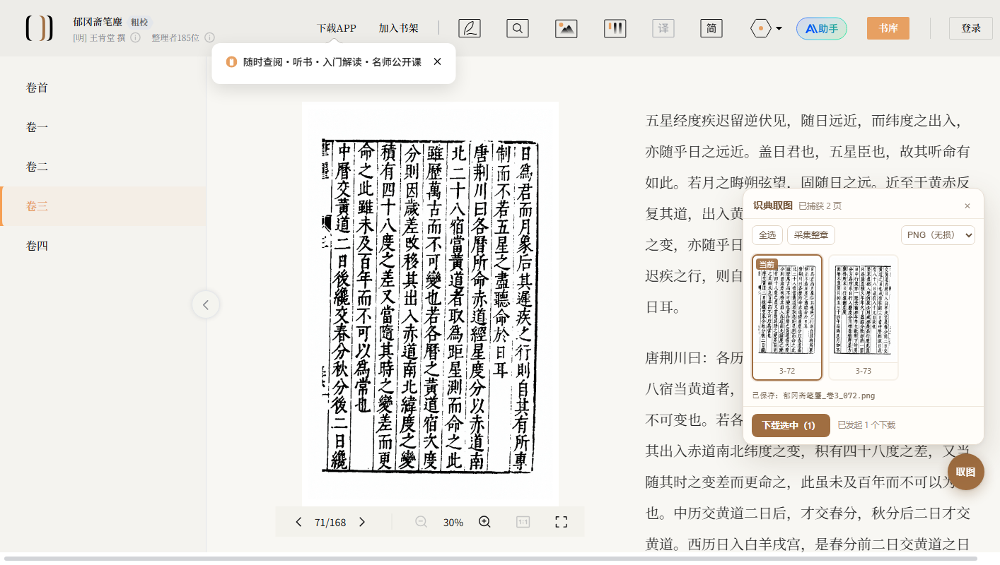

# 识典古籍取图（Chrome 扩展）

**一句话**：点一下「取图」按钮，把阅读器里**正在显示的那一整页原图**存下来——整页、没有底色、不用裁。



---

## 一、为什么右键下不到

识典古籍的影像页不是 `` 标签，它是用 **Konva**（一个 canvas 绘图库）把图画在画布上的。

- 右键 →「图片另存为」：canvas 上没有"图片"这个东西，只能截图
- 截图：只能拿到屏幕上那一块，还带着阅读器的米色底

但图**一定**会以网络请求的形式加载过一次，而且 Konva 把"正在显示哪张图"挂在了 `window.Konva` 上。这个扩展就是顺着这两条路把原图地址找出来的。

---

## 二、装法

1. 打开 `chrome://extensions/`
2. 右上角打开「开发者模式」
3. 点「加载已解压的扩展程序」，选这个 `extension` 文件夹
4. 回到识典古籍页面，**刷新一次**

装好后，页面右下角会多一个圆形的「取图」按钮。

---

## 三、用法

| 想做什么 | 怎么做 |
|---|---|
| 存当前这一页 | 点「取图」→ 面板里**当前页已经自动选中** → 点「下载选中（1）」 |
| 存好几页 | 在面板里点缩略图多选（选中的是棕框），再点「下载选中」 |
| 存整章 | 点「采集整章」。它会用站点自己的翻页按钮从头翻到尾，把每页地址都记下来 |

**「采集整章」是让它自己翻页**（大约 1 秒多一页），期间别动页面。一卷 168 页大概 3～4 分钟，超过 80 页会先弹确认。采完会自动翻回你原来那一页，然后点「全选」再下载。

**看原图**：双击缩略图，在新标签打开原图。

---

## 四、存到哪、叫什么名、什么格式

直接落在**默认下载目录**里（不套子文件夹），名字是这个格式：

```
郁冈斋笔麈_卷3_072.png
  └─ 书名 ┘ │   └ 该卷第 72 页（三位补零）
             └ 卷号（图片路径里的册号）
```

- **书名**取自站点自己的数据 `_ROUTER_DATA.bookInfo.bookName`，不是抄页面上的大标题 ——
  大标题会跟着「简/繁」显示开关变，站点存的那份才是规范名。
- **一律简体**。万一拿到的是繁体，会用内置的繁→简表转过来；这张表带"例外词"，
  所以 **乾隆 / 乾卦 不会被转成 干隆 / 干卦**（逐字表最容易犯的错就是这个）。
- **卷号、页号**从图片地址本身解出来（`…-3-72.webp`），不是猜的。

**文件名常驻显示在面板上**（「下载选中」上方那行小字），换格式、改选择立刻跟着变，
不用悬停去猜；下完之后会变成 `已保存：郁冈斋笔麈_卷3_072.png`，可以当场核对。

右下角那个下拉框决定存成什么格式，选一次就记住：

| 选项 | 什么时候用 |
|---|---|
| **原格式 WebP**（默认） | 只是存着、体积最小。缺点：塞进 Word/PPT 可能不认 |
| **PNG（无损）** | 要再处理（去底、二值化、OCR、印刷）、要能进任何软件。缺点：每页 3 MB |
| **JPG（92%）** | 要发给别人、要小。肉眼看不出差别，但它是**有损的** |

为什么这么选，见下一节。

> **关于「存成『下载』这个没扩展名的文件」**
> 1.0 版把转好的图用 `data:` URL 交给下载器。`data:` URL 没有路径，
> 一旦浏览器在"决定文件名"这一步要自己猜（例如开了「下载前询问每个文件的保存位置」），
> 猜出来就是本地化的 `download` → 中文界面下就是「下载」，且没有扩展名。
> 1.1 版改了两处：转换放进**离屏文档**产出标准 `blob:` 链接；
> 同时挂上 `downloads.onDeterminingFilename`，在下载器拍板的最后一步把名字按下去
> （这一层连"询问保存位置"的对话框都管得到）。文件名这件事不再靠运气。

---

## 五、PNG 还是 JPG？——先给结论再给数

**通用答案：PNG 质量好。** PNG 是无损压缩，解码回来一个像素都不差；JPG 是有损的，一定会丢东西。

**但对你这个场景有个前提必须先说**：**站点给你的原图本身已经是压过的有损 WebP。** 我拿同一张图做了对照——原文件 555 KB，把同一画面用无损方式重压需要 1129 KB，比值 2.04。所以：

> 转 PNG **不会让图变清楚**，只能做到"不再掉第二次质量"。想让古籍扫描件更清楚，从这张 1200×1895 的有损图上做不到。

实测数据（`郁冈斋笔麈 卷3 第72页`，1200×1895 = 2.27 百万像素）：

| 格式 | 体积 | 每像素 | 与原图的 PSNR |
|---|---|---|---|
| 原 WebP（站点给的，有损） | 555 KB | 0.24 B | — |
| 无损 WebP | 1129 KB | 0.51 B | ∞ |
| **PNG（无损）** | 2028 KB（PIL 优化）/ 2950 KB（浏览器出） | 0.91 / 1.30 B | **∞** |
| JPEG q95 | 860 KB | 0.39 B | 46.3 dB |
| **JPEG q92** | 681 KB | 0.31 B | 43.5 dB |
| JPEG q90 | 629 KB | 0.28 B | 42.0 dB |
| 灰度 PNG | 811 KB | 0.37 B | ∞ |

（PSNR 是与原图比，越高越接近。40 dB 以上基本看不出差别，45 dB 以上基本测不出。）


*同一块字，3 倍最近邻放大。左：PNG（无损）　右：JPG 92%——看图看不出差别，差的是"能不能再掉一次质量"。*

**所以三条实用建议：**

1. **存档 / 要再加工** → PNG。虽然撑到 3 MB，但它是唯一"不再掉质量"的选择。
2. **放文档、发人、体积敏感** → JPG 92%。598 KB，跟原图几乎一样大，3 倍放大对比也看不出差别。
3. **只想存一份** → 就用原 WebP。同质量下它比 JPG 还小 30～50%。

**真正想省体积又保无损，答案是转灰度**：这张扫描件本来就只有黑白字，灰度 PNG 只要 811 KB（彩色 PNG 的 40%），像素一个不丢。浏览器 canvas 出不了灰度 PNG，用工具转一步：

```bash
magick 郁冈斋笔麈_卷3_072.png -colorspace Gray 灰度版.png
```

---

## 六、关于「更清晰」——上限

这张图在站上**最大就是 1200×1895**。

我验证过三种取法，拿到的像素数完全一样：

| 取法 | 结果 |
|---|---|
| `~tplv-...-image.image`（原图模板，扩展走这条） | 1200×1895，555 KB WebP |
| `~tplv-...-png.png`（PNG 模板） | 1200×1895，2.1 MB PNG |
| 放大到 100% 后再截图 | ≤1200×1895，而且只有可见的那块 |

响应头里 `Imagex-Fmt: webp2webp` 说明服务端只做了"转码"，没有缩放——对象本身就是 1200 宽。所以**扩展能保证你拿到的是站点上的最好版本，但它变不出更多像素**。

真要更高清，只能去找这书的原始扫描方（这本书的编号 `CADAL02038284` 是 **CADAL**（大学数字图书馆国际合作计划）的编号，那边可能有更高精度的图），站点这边没有。

---

## 七、不想装扩展？控制台一行

在阅读页按 F12 → Console，粘这行回车：

```js
(()=>{const s=(window.Konva&&Konva.stages)||[];for(const st of s){const n=st.find('Image');if(n.length){const i=n[n.length-1].image();if(!i||!i.src)continue;console.log(i.src);try{copy(i.src)}catch(e){}alert('原图地址已打印到控制台（也已复制）。粘到新标签页打开，Ctrl+S 保存。');return}}alert('没找到影像：先切到「对照」或「影像」视图')})()
```

（Chrome 第一次会问"是否允许粘贴"，输入 `allow pasting` 回车。）

拿到地址后新标签页打开，直接右键「图片另存为」或 Ctrl+S —— 那已经是纯图片，没有 canvas 也没有底色。

**为什么不直接 `a.download`**：那个属性对跨域地址是无效的，浏览器会把它当成普通链接跳走；而用 `fetch` 取回来再转 blob 会被 CORS 挡住（`Failed to fetch`，实测）。所以最稳的是把地址交给你自己去存。

这个办法每次只能拿当前一页，胜在不用装东西。

---

## 八、边界

- 只读你已经能看到的那些页，不绕任何登录/权限
- 建议只用于个人阅读、研究、引用
- 别拿去整库批量抓——那既不合站方规矩，也容易把你的 IP 送进风控

---

## 文件清单

```
extension/
  manifest.json      MV3 清单
  background.js      记下整页原图地址；下载；管文件名
  main-world.js      主世界里读 window.Konva（当前显示图）和 _ROUTER_DATA（规范书名）
  content.js         页面内的「取图」面板、文件名规则、繁简转换
  t2s-table.js       繁→简对照表（zhconv zh-cn 词典 + 例外词，自动生成）
  offscreen.html/js  离屏文档：把整页图转成 PNG/JPG 并产出 blob: 链接
  content.css        面板样式
  icons/             图标
docs/panel.png       面板截图
samples/
  郁冈斋笔麈_卷3_072.webp   你要的那一页（原始 WebP，555 KB）
  郁冈斋笔麈_卷3_072.png    同上，PNG（无损），2.1 MB
```
